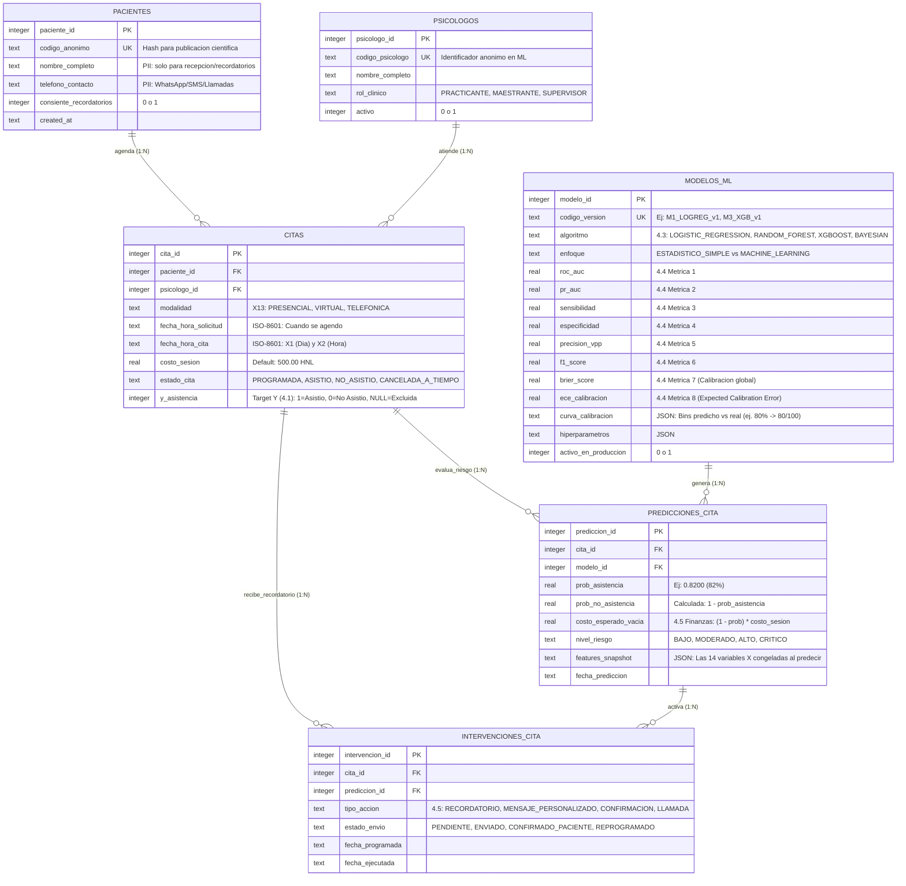

# Diseño de Base de Datos (Versión Simplificada y Pragmática): Predicción de Asistencia a Sesiones Psicológicas

> **Proyecto de Investigación:** *“Modelo probabilístico de bajo costo para predicción de asistencia a sesiones de psicología basado en registros históricos de una clínica universitaria.”*  
> **Motor de Referencia:** SQLite 3 (3.31+) / PostgreSQL 16+  
> **Arquitectura:** **6 Tablas Esenciales (3NF) + 1 Vista Analítica sin *Data Leakage*** (Principios *KISS* y *Privacy by Design*)

---

## 1. Paso a Paso: ¿Cómo Simplificamos sin Perder Buenas Prácticas?

Para que el sistema sea realmente de **bajo costo, fácil de mantener por un equipo pequeño y científicamente riguroso para publicación**, aplicamos cuatro decisiones de simplificación arquitectónica reduciendo el diseño de 11 tablas a **6 tablas núcleo + 1 vista SQL**:

| Qué se simplificó | Cómo estaba antes | Cómo queda ahora (Simplificado) | ¿Por qué mantiene las buenas prácticas? |
| :--- | :--- | :--- | :--- |
| **1. De tabla física de *Features* a Vista SQL con *Window Functions*** | Tabla redundante de 18 columnas (`feature_snapshots_cita`) que requería un proceso ETL para llenarse. | **Vista `vw_dataset_ml`** que calcula las **14 variables (4.2)** al vuelo a partir de `citas`, más una columna `features_json` en `predicciones_cita`. | Evita duplicar datos (mantiene **3ª Forma Normal pura**), elimina sincronizaciones manuales y garantiza **cero *Data Leakage*** usando ventanas históricas (`1 PRECEDING`). |
| **2. Consolidación de Modelo + Métricas + Calibración** | 3 tablas separadas (`modelos`, `evaluaciones_modelo`, `curvas_calibracion_modelo`). | **1 sola tabla `modelos_ml`** con las **8 métricas (4.4)** en columnas tipadas y los deciles de la curva de calibración en `curva_calibracion JSONB`. | Cada entrenamiento de los 4 modelos (Logística, RF, XGBoost, Bayesiano) produce un conjunto único de métricas en validación/test (relación 1:1 por versión). |
| **3. Privacidad Ética en 1 sola tabla de Pacientes** | 2 tablas (`pacientes` y `pacientes_pii`). | **1 tabla `pacientes`** con `codigo_anonimo` para ciencia de datos; la vista `vw_dataset_ml` **jamás expone** nombre, teléfono ni variables sensibles. | Cumple *Privacy by Design* y equidad algorítmica mediante aislamiento en capa de vistas y permisos de columnas (`GRANT SELECT (paciente_id, codigo_anonimo)`). |
| **4. Catálogos estáticos a `CHECK` / `ENUM` y Tarifa en `citas`** | Tablas extra para `modalidades`, `tarifario` e `historial_estados`. | `modalidad` controlada por `CHECK` (`PRESENCIAL`, `VIRTUAL`, `TELEFONICA`) y `costo_sesion` en `citas` con `DEFAULT 500.00`. | Preserva la inmutabilidad financiera histórica (si mañana la sesión sube a L 600, las citas pasadas conservan sus L 500.00) sin requerir `JOINs` innecesarios. |

---

## 2. Diagrama Entidad-Relación Simplificado (6 Tablas)



---

## 3. Trazabilidad Completa de las 14 Variables Predictoras (4.2) y el Target (4.1)

Todas las variables del requerimiento existen sin redundancia: **5 se guardan directamente en `citas`** y **9 se derivan matemáticamente en la vista `vw_dataset_ml`** garantizando que jamás se filtre información del futuro:

| # | Variable Requerida (Sección 4.1 y 4.2) | Origen Exacto en la Base de Datos Simplificada |
| :--- | :--- | :--- |
| **Y** | **Asistencia ($1 = \text{asistió}, 0 = \text{no asistió}$)** | Columna calculada `citas.y_asistencia` (`1` si `ASISTIO`, `0` si `NO_ASISTIO`). |
| **X1** | **Día** | `DATE(citas.fecha_hora_cita)` en `vw_dataset_ml`. |
| **X2** | **Hora** | `EXTRACT(HOUR FROM citas.fecha_hora_cita)` + minutos en decimal en `vw_dataset_ml`. |
| **X3** | **Psicólogo** | `citas.psicologo_id` (Clave foránea a `psicologos`). |
| **X4** | **Paciente** | `citas.paciente_id` / `pacientes.codigo_anonimo` (Sin datos sensibles ni PII). |
| **X5** | **Número de sesiones previas** | `SUM(y_asistencia = 1)` sobre las citas previas del paciente (`w_previas`). |
| **X6** | **Asistencia histórica** | Proporción histórica suavizada $\frac{\text{sesiones\_previas} + \alpha}{\text{citas\_anteriores} + \alpha + \beta}$ en `vw_dataset_ml`. |
| **X7** | **Inasistencias** | `SUM(y_asistencia = 0)` sobre las citas previas del paciente (`w_previas`). |
| **X8** | **Tiempo desde última sesión** | Diferencia en días entre `fecha_hora_cita` actual y `LAG(fecha_hora_cita)` previa. |
| **X9** | **Número de citas anteriores** | `COUNT(y_asistencia)` sobre las citas previas cerradas del paciente (`w_previas`). |
| **X10** | **Anticipación de la cita** | Diferencia en días/horas entre `fecha_hora_cita` y `fecha_hora_solicitud`. |
| **X11** | **Día de la semana** | `EXTRACT(ISODOW FROM fecha_hora_cita)` ($1 = \text{Lunes} \dots 7 = \text{Domingo}$). |
| **X12** | **Mes** | `EXTRACT(MONTH FROM fecha_hora_cita)` ($1 \dots 12$). |
| **X13** | **Modalidad** | `citas.modalidad` (`PRESENCIAL`, `VIRTUAL`, `TELEFONICA`). |
| **X14** | **Primera cita / recurrente** | Booleano `(num_citas_anteriores = 0) AS es_primera_cita`. |

---

## 4. Script SQL Completo en SQLite 3 (Listo para Producción, Móvil y Python)

Este script está optimizado para **SQLite 3.31+** (compatible nativamente con Python `sqlite3`, Android Room / SQLDelight y Flutter `sqflite`):

```sql
-- =============================================================================
-- DISEÑO SIMPLIFICADO EN SQLITE 3 (6 TABLAS + 1 VISTA SIN DATA LEAKAGE)
-- Proyecto: Predicción de Asistencia a Sesiones Psicológicas
-- =============================================================================

-- Activar integridad referencial obligatoria en SQLite
PRAGMA foreign_keys = ON;
PRAGMA journal_mode = WAL;

-- -----------------------------------------------------------------------------
-- TABLA 1: PACIENTES (Sin variables demográficas sensibles para evitar sesgos)
-- -----------------------------------------------------------------------------
CREATE TABLE IF NOT EXISTS pacientes (
    paciente_id INTEGER PRIMARY KEY AUTOINCREMENT,
    codigo_anonimo TEXT NOT NULL UNIQUE, -- Hash/código anónimo para ciencia de datos
    -- Datos de contacto exclusivos para envío de recordatorios (no expuestos en ML)
    nombre_completo TEXT NOT NULL,
    telefono_contacto TEXT NOT NULL,
    consiente_recordatorios INTEGER NOT NULL DEFAULT 1
        CHECK (consiente_recordatorios IN (0, 1)),
    created_at TEXT NOT NULL DEFAULT (datetime('now', 'localtime'))
);

-- -----------------------------------------------------------------------------
-- TABLA 2: PSICÓLOGOS
-- -----------------------------------------------------------------------------
CREATE TABLE IF NOT EXISTS psicologos (
    psicologo_id INTEGER PRIMARY KEY AUTOINCREMENT,
    codigo_psicologo TEXT NOT NULL UNIQUE,
    nombre_completo TEXT NOT NULL,
    rol_clinico TEXT NOT NULL DEFAULT 'PRACTICANTE'
        CHECK (rol_clinico IN ('PRACTICANTE', 'MAESTRANTE', 'PSICOLOGO_PLANTA', 'SUPERVISOR')),
    activo INTEGER NOT NULL DEFAULT 1 CHECK (activo IN (0, 1)),
    created_at TEXT NOT NULL DEFAULT (datetime('now', 'localtime'))
);

-- -----------------------------------------------------------------------------
-- TABLA 3: CITAS (Transaccional + Variable Dependiente Y + Costo Sesión L 500)
-- -----------------------------------------------------------------------------
CREATE TABLE IF NOT EXISTS citas (
    cita_id INTEGER PRIMARY KEY AUTOINCREMENT,
    paciente_id INTEGER NOT NULL REFERENCES pacientes(paciente_id) ON DELETE RESTRICT,
    psicologo_id INTEGER NOT NULL REFERENCES psicologos(psicologo_id) ON DELETE RESTRICT,
    
    -- 4.2 Variable 13: Modalidad
    modalidad TEXT NOT NULL DEFAULT 'PRESENCIAL'
        CHECK (modalidad IN ('PRESENCIAL', 'VIRTUAL', 'TELEFONICA')),
    
    -- Fechas en formato ISO-8601 ('YYYY-MM-DD HH:MM:SS')
    fecha_hora_solicitud TEXT NOT NULL DEFAULT (datetime('now', 'localtime')),
    fecha_hora_cita TEXT NOT NULL,
    
    -- 4.5 Finanzas: Costo por sesión en Lempiras (por defecto L 500.00)
    costo_sesion REAL NOT NULL DEFAULT 500.00 CHECK (costo_sesion >= 0),
    
    -- Estado operativo de la cita
    estado_cita TEXT NOT NULL DEFAULT 'PROGRAMADA'
        CHECK (estado_cita IN (
            'PROGRAMADA',           -- Pendiente de realizarse
            'ASISTIO',              -- Y = 1
            'NO_ASISTIO',           -- Y = 0 (No-Show)
            'CANCELADA_TARDIA',     -- Y = 0 (Canceló sin tiempo para reasignar)
            'CANCELADA_A_TIEMPO',   -- Excluida de entrenamiento (avisó con antelación)
            'ANULADA_CLINICA'       -- Excluida de entrenamiento (causa de la clínica)
        )),
    
    -- 4.1 Variable Dependiente (Y): 1 = asistió, 0 = no asistió, NULL = pendiente/excluida
    y_asistencia INTEGER GENERATED ALWAYS AS (
        CASE
            WHEN estado_cita = 'ASISTIO' THEN 1
            WHEN estado_cita IN ('NO_ASISTIO', 'CANCELADA_TARDIA') THEN 0
            ELSE NULL
        END
    ) STORED,
    
    created_at TEXT NOT NULL DEFAULT (datetime('now', 'localtime')),
    CONSTRAINT chk_fechas_coherentes CHECK (julianday(fecha_hora_cita) >= julianday(fecha_hora_solicitud))
);

-- -----------------------------------------------------------------------------
-- TABLA 4: MODELOS_ML (Los 4 Modelos [4.3] + Las 8 Métricas y Calibración [4.4])
-- -----------------------------------------------------------------------------
CREATE TABLE IF NOT EXISTS modelos_ml (
    modelo_id INTEGER PRIMARY KEY AUTOINCREMENT,
    codigo_version TEXT NOT NULL UNIQUE, -- Ej: 'M1_LOGREG_V1', 'M2_RF_V1', 'M3_XGB_V1', 'M4_BAYES_V1'
    
    -- 4.3 Los 4 algoritmos requeridos y su clasificación
    algoritmo TEXT NOT NULL
        CHECK (algoritmo IN ('LOGISTIC_REGRESSION', 'RANDOM_FOREST', 'XGBOOST', 'BAYESIAN')),
    enfoque TEXT NOT NULL
        CHECK (enfoque IN ('ESTADISTICO_SIMPLE', 'MACHINE_LEARNING', 'BAYESIANO')),
    
    -- 4.4 Las 8 métricas obligatorias de evaluación (validadas entre 0 y 1)
    roc_auc REAL NOT NULL CHECK (roc_auc BETWEEN 0.0 AND 1.0),
    pr_auc REAL NOT NULL CHECK (pr_auc BETWEEN 0.0 AND 1.0),
    sensibilidad REAL NOT NULL CHECK (sensibilidad BETWEEN 0.0 AND 1.0),
    especificidad REAL NOT NULL CHECK (especificidad BETWEEN 0.0 AND 1.0),
    precision_vpp REAL NOT NULL CHECK (precision_vpp BETWEEN 0.0 AND 1.0),
    f1_score REAL NOT NULL CHECK (f1_score BETWEEN 0.0 AND 1.0),
    brier_score REAL NOT NULL CHECK (brier_score BETWEEN 0.0 AND 1.0),
    ece_calibracion REAL NOT NULL CHECK (ece_calibracion BETWEEN 0.0 AND 1.0),
    
    -- Desglose de calibración por deciles en JSON (Ej: [{"bin": 0.8, "n": 100, "asistieron": 80}])
    curva_calibracion TEXT NOT NULL DEFAULT '[]' CHECK (json_valid(curva_calibracion)),
    hiperparametros TEXT NOT NULL DEFAULT '{}' CHECK (json_valid(hiperparametros)),
    
    activo_en_produccion INTEGER NOT NULL DEFAULT 0 CHECK (activo_en_produccion IN (0, 1)),
    fecha_entrenamiento TEXT NOT NULL DEFAULT (datetime('now', 'localtime'))
);

-- -----------------------------------------------------------------------------
-- TABLA 5: PREDICCIONES_CITA (Probabilidad Calibrada + Costo Esperado Sesión Vacía)
-- -----------------------------------------------------------------------------
CREATE TABLE IF NOT EXISTS predicciones_cita (
    prediccion_id INTEGER PRIMARY KEY AUTOINCREMENT,
    cita_id INTEGER NOT NULL REFERENCES citas(cita_id) ON DELETE CASCADE,
    modelo_id INTEGER NOT NULL REFERENCES modelos_ml(modelo_id) ON DELETE RESTRICT,
    
    -- 4.4 Probabilidad calibrada de asistir (Ej. Paciente A = 0.82 -> 82%)
    prob_asistencia REAL NOT NULL CHECK (prob_asistencia BETWEEN 0.0 AND 1.0),
    prob_no_asistencia REAL GENERATED ALWAYS AS (ROUND(1.0 - prob_asistencia, 4)) STORED,
    
    -- 4.5 Finanzas: Costo esperado de sesión vacía = P(No-Show) * Costo Sesión (Ej. 0.40 * 500 = L 200.00)
    costo_sesion_base REAL NOT NULL DEFAULT 500.00 CHECK (costo_sesion_base >= 0),
    costo_esperado_vacia REAL GENERATED ALWAYS AS (
        ROUND((1.0 - prob_asistencia) * costo_sesion_base, 2)
    ) STORED,
    
    -- Semáforo para activar recordatorios/llamadas (sin sobreagendar)
    nivel_riesgo TEXT GENERATED ALWAYS AS (
        CASE
            WHEN (1.0 - prob_asistencia) < 0.15 THEN 'BAJO'
            WHEN (1.0 - prob_asistencia) < 0.30 THEN 'MODERADO'
            WHEN (1.0 - prob_asistencia) < 0.50 THEN 'ALTO'
            ELSE 'CRITICO'
        END
    ) STORED,
    
    -- Instantánea JSON de las 14 variables en el momento exacto de predecir
    features_snapshot TEXT NOT NULL DEFAULT '{}' CHECK (json_valid(features_snapshot)),
    fecha_prediccion TEXT NOT NULL DEFAULT (datetime('now', 'localtime'))
);

-- -----------------------------------------------------------------------------
-- TABLA 6: INTERVENCIONES_CITA (Recordatorios, Llamadas, Confirmaciones, Mensajes)
-- -----------------------------------------------------------------------------
CREATE TABLE IF NOT EXISTS intervenciones_cita (
    intervencion_id INTEGER PRIMARY KEY AUTOINCREMENT,
    cita_id INTEGER NOT NULL REFERENCES citas(cita_id) ON DELETE CASCADE,
    prediccion_id INTEGER REFERENCES predicciones_cita(prediccion_id) ON DELETE SET NULL,
    
    -- 4.5 Acciones preventivas éticas (en lugar de sobreagendar pacientes)
    tipo_accion TEXT NOT NULL
        CHECK (tipo_accion IN ('RECORDATORIO', 'MENSAJE_PERSONALIZADO', 'CONFIRMACION', 'LLAMADA')),
    
    estado_envio TEXT NOT NULL DEFAULT 'PENDIENTE'
        CHECK (estado_envio IN ('PENDIENTE', 'ENVIADO', 'CONFIRMADO_PACIENTE', 'SOLICITA_REPROGRAMAR', 'SIN_RESPUESTA')),
    
    fecha_programada TEXT NOT NULL,
    fecha_ejecutada TEXT,
    created_at TEXT NOT NULL DEFAULT (datetime('now', 'localtime'))
);

-- -----------------------------------------------------------------------------
-- ÍNDICES ESENCIALES
-- -----------------------------------------------------------------------------
CREATE INDEX IF NOT EXISTS idx_citas_historial_paciente ON citas (paciente_id, fecha_hora_cita, cita_id);
CREATE INDEX IF NOT EXISTS idx_citas_programadas ON citas (fecha_hora_cita) WHERE estado_cita = 'PROGRAMADA';
CREATE UNIQUE INDEX IF NOT EXISTS idx_unico_modelo_produccion ON modelos_ml (activo_en_produccion) WHERE activo_en_produccion = 1;

-- =============================================================================
-- VISTA ANALÍTICA EN SQLITE: LAS 14 VARIABLES (4.2) + TARGET Y (4.1) SIN LEAKAGE
-- =============================================================================
CREATE VIEW IF NOT EXISTS vw_dataset_ml AS
WITH historial_punto_en_el_tiempo AS (
    SELECT
        c.cita_id,
        c.paciente_id,
        p.codigo_anonimo AS paciente_codigo_anonimo,
        c.psicologo_id,
        c.modalidad,
        c.fecha_hora_solicitud,
        c.fecha_hora_cita,
        c.costo_sesion,
        c.estado_cita,
        c.y_asistencia,
        
        -- X5: Número de sesiones previas asistidas (estrictamente anteriores a la cita actual)
        COALESCE(SUM(CASE WHEN c.y_asistencia = 1 THEN 1 ELSE 0 END) OVER w_previas, 0) AS num_sesiones_previas,
        
        -- X7: Inasistencias previas acumuladas
        COALESCE(SUM(CASE WHEN c.y_asistencia = 0 THEN 1 ELSE 0 END) OVER w_previas, 0) AS num_inasistencias_previas,
        
        -- X9: Número total de citas anteriores cerradas
        COALESCE(COUNT(c.y_asistencia) OVER w_previas, 0) AS num_citas_anteriores,
        
        -- Fecha de la cita inmediata anterior para calcular X8
        LAG(c.fecha_hora_cita, 1) OVER (
            PARTITION BY c.paciente_id ORDER BY c.fecha_hora_cita ASC, c.cita_id ASC
        ) AS fecha_ultima_cita
    FROM citas c
    JOIN pacientes p ON p.paciente_id = c.paciente_id
    WHERE c.estado_cita NOT IN ('CANCELADA_A_TIEMPO', 'ANULADA_CLINICA')
    WINDOW w_previas AS (
        PARTITION BY c.paciente_id
        ORDER BY c.fecha_hora_cita ASC, c.cita_id ASC
        ROWS BETWEEN UNBOUNDED PRECEDING AND 1 PRECEDING
    )
)
SELECT
    cita_id,
    -- 4.2 Variables Predictoras (X1 a X14)
    date(fecha_hora_cita) AS dia_cita,                                                                  -- 1. Día
    ROUND(CAST(strftime('%H', fecha_hora_cita) AS REAL) +
          CAST(strftime('%M', fecha_hora_cita) AS REAL) / 60.0, 2) AS hora_cita,                        -- 2. Hora (decimal)
    psicologo_id,                                                                                       -- 3. Psicólogo
    paciente_codigo_anonimo,                                                                            -- 4. Paciente (anónimo)
    num_sesiones_previas,                                                                               -- 5. Sesiones previas
    ROUND((num_sesiones_previas + 3.0) / (num_citas_anteriores + 4.0), 4) AS asistencia_historica,      -- 6. Asistencia histórica (suavizada)
    num_inasistencias_previas AS inasistencias,                                                         -- 7. Inasistencias
    CASE
        WHEN fecha_ultima_cita IS NULL THEN NULL
        ELSE ROUND(julianday(fecha_hora_cita) - julianday(fecha_ultima_cita), 2)
    END AS dias_desde_ultima_sesion,                                                                    -- 8. Tiempo desde última sesión
    num_citas_anteriores,                                                                               -- 9. Número de citas anteriores
    ROUND(julianday(fecha_hora_cita) - julianday(fecha_hora_solicitud), 2) AS anticipacion_cita_dias,   -- 10. Anticipación de la cita (días)
    CASE CAST(strftime('%w', fecha_hora_cita) AS INTEGER)
        WHEN 0 THEN 7
        ELSE CAST(strftime('%w', fecha_hora_cita) AS INTEGER)
    END AS dia_semana,                                                                                  -- 11. Día de la semana ISO (1=Lun..7=Dom)
    CAST(strftime('%m', fecha_hora_cita) AS INTEGER) AS mes,                                            -- 12. Mes (1..12)
    modalidad,                                                                                          -- 13. Modalidad
    CASE WHEN num_citas_anteriores = 0 THEN 1 ELSE 0 END AS es_primera_cita,                            -- 14. Primera cita (1) / recurrente (0)
    
    -- 4.1 Variable Dependiente (Y)
    y_asistencia
FROM historial_punto_en_el_tiempo;
```

---

## 5. ¿Por qué esta versión simplificada es ideal para tu proyecto?

1. **Cero mantenimiento de pipelines complejos:** En Python (`scikit-learn` / `xgboost` / `pymc`), para entrenar los 4 modelos basta ejecutar `SELECT * FROM vw_dataset_ml WHERE y_asistencia IS NOT NULL;`.
2. **Integridad automática en la base de datos:**
   * `y_asistencia` se calcula solo cuando cambia `estado_cita`.
   * `costo_esperado_vacia` ($\text{L } 500 \times P(\text{No-Show})$) y `nivel_riesgo` se calculan solos cuando el modelo inserta `prob_asistencia`.
3. **Listo para el artículo científico:** Con solo 6 tablas tienes cubiertos el diseño experimental (4 modelos), las 8 métricas con calibración (`brier_score`, `ece_calibracion`, `curva_calibracion`), el análisis económico en Lempiras y el registro de intervenciones preventivas éticas.
